<p align="center">
  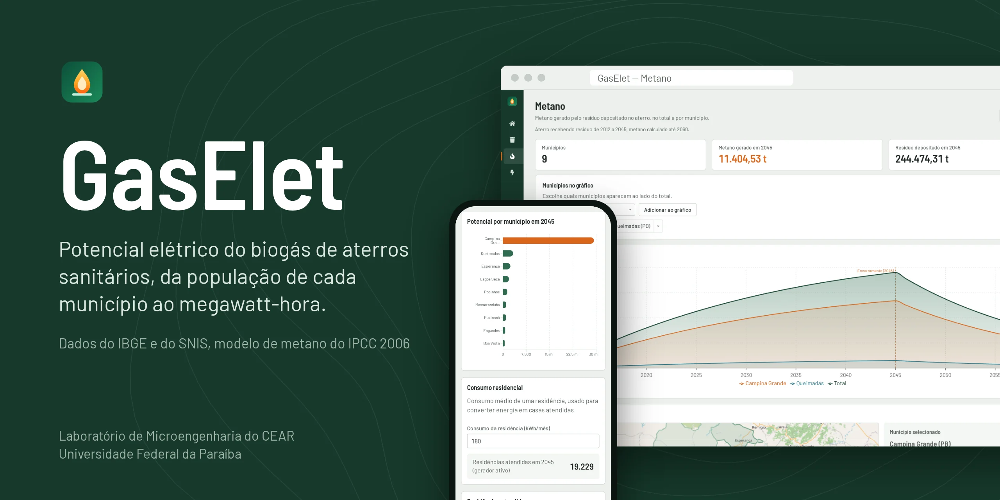
</p>

<p align="center">
  
  
  
  
  
  
  
  
  
</p>

<p align="center">
  <b>Plataforma para avaliar o potencial de geração de energia elétrica do biogás de aterros sanitários.</b><br>
  População, resíduos sólidos urbanos, metano e energia, município a município,<br>
  em cenários que se montam e se comparam no navegador.
</p>

<p align="center">
  <a href="#sobre">Sobre</a> ·
  <a href="#funcionalidades">Funcionalidades</a> ·
  <a href="#capturas-de-tela">Capturas</a> ·
  <a href="#modelo-de-cálculo">Modelo</a> ·
  <a href="#arquitetura">Arquitetura</a> ·
  <a href="#como-rodar">Como rodar</a> ·
  <a href="#api">API</a> ·
  <a href="#fontes-de-dados">Fontes</a> ·
  <a href="#licença">Licença</a>
</p>

<br>

## Sobre

O resíduo orgânico enterrado num aterro sanitário se decompõe sem oxigênio e libera biogás, rico em metano, por décadas depois da deposição. Esse metano pode ser queimado em flare ou virar eletricidade num motor-gerador. Avaliar se vale a pena exige uma cadeia de estimativas: quantas pessoas o aterro atende, quanto resíduo elas geram, quanto metano esse resíduo produz ao longo do tempo e quanta energia um gerador consegue tirar dele.

O **GasElet** faz essa cadeia inteira numa única tela por etapa:

- o usuário monta um **cenário** escolhendo os municípios que mandam resíduo para o aterro, e a plataforma soma as séries de população de 2000 a 2060;
- a massa de **resíduos sólidos urbanos** sai da população, da geração per capita de cada UF (curvas ajustadas ao SNIS) e da taxa de coleta;
- o **metano** é calculado pelo modelo de decaimento de primeira ordem do IPCC, com a composição do resíduo, o tipo de aterro e a zona climática;
- a **energia elétrica** depende do gerador escolhido, da potência instalada e da disponibilidade, e é traduzida em residências atendidas.

No topo de todas as telas, um resumo do aterro mostra o cenário em uso: municípios, região, população, resíduo previsto e o período de operação numa linha do tempo.

O cálculo fica numa **API em C++ (Drogon)**, e a interface é uma **SPA React** com gráficos e mapas por município. Cada usuário tem seus cenários salvos no servidor, sem banco de dados: um arquivo JSON por usuário.

<table>
  <tr>
    <td align="center" width="25%"><h3>5.566</h3><sub>municípios com população<br>projetada de 2000 a 2060</sub></td>
    <td align="center" width="25%"><h3>27</h3><sub>UFs com curva per capita<br>do SNIS (15 próprias)</sub></td>
    <td align="center" width="25%"><h3>19</h3><sub>anos de dados do SNIS<br>(2003–2021) nas curvas</sub></td>
    <td align="center" width="25%"><h3>9</h3><sub>frações na composição<br>gravimétrica do resíduo</sub></td>
  </tr>
  <tr>
    <td align="center"><h3>4</h3><sub>zonas climáticas do IPCC<br>para a constante k</sub></td>
    <td align="center"><h3>4</h3><sub>classes de aterro (MCF,<br>IPCC 2006 Tab. 3.1)</sub></td>
    <td align="center"><h3>3</h3><sub>discretizações do<br>decaimento (FOD)</sub></td>
    <td align="center"><h3>4</h3><sub>geradores<br>pré-configurados</sub></td>
  </tr>
</table>

<p align="center">
  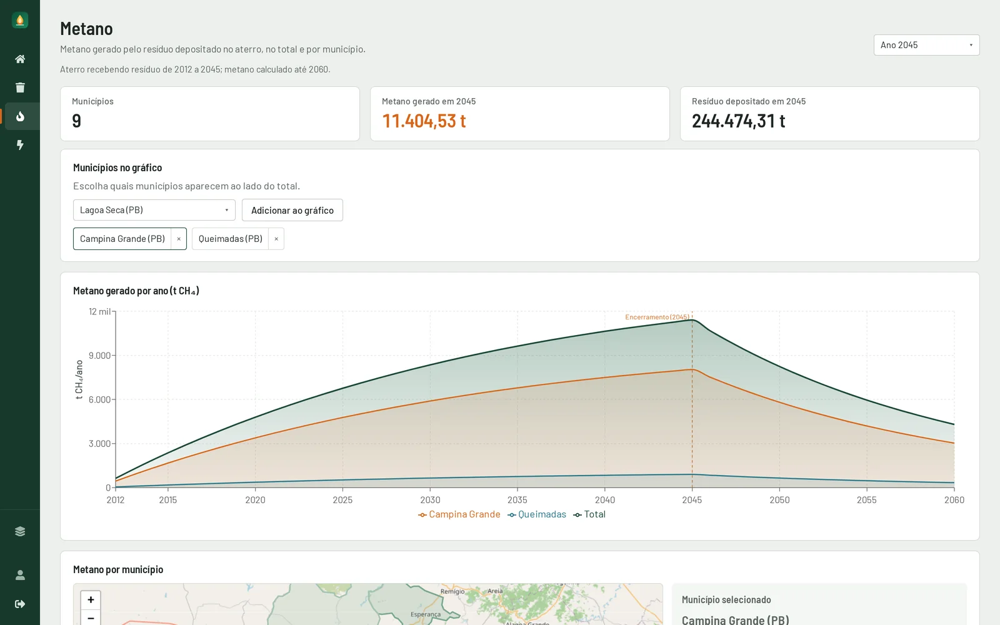
  <br><sub><b>Metano</b>: no topo, o resumo do aterro; abaixo, metano gerado e recuperado no ano escolhido e a curva anual, no total e por município, com a linha de encerramento do aterro. Cenário de exemplo usado em todas as capturas: 9 municípios em torno de Campina Grande (PB), aterro operando de 2012 a 2045.</sub>
</p>

<details>
  <summary><b>Ver a tela de Energia inteira</b></summary>
  <br>
  <p align="center">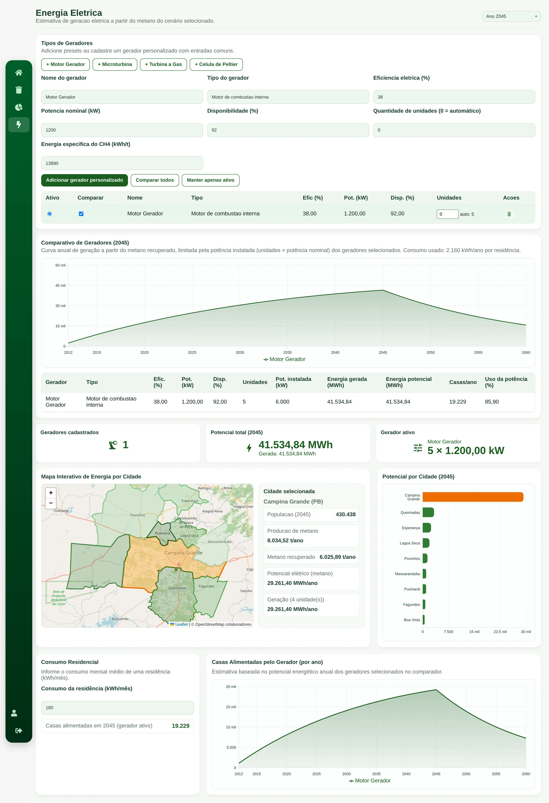</p>
</details>

## Funcionalidades

<table>
  <tr>
    <td width="33%" valign="top">
      <br>
      <b>Cenários</b><br>
      <sub>Vários cenários por usuário, cada um com seus municípios, período e parâmetros, resumidos no topo de cada tela. Criar, renomear e excluir pela barra lateral.</sub>
    </td>
    <td width="33%" valign="top">
      <br>
      <b>População municipal</b><br>
      <sub>Séries anuais de 2000 a 2060 para 5.566 municípios. O cenário soma os municípios escolhidos e mostra o crescimento e a participação de cada uma.</sub>
    </td>
    <td width="33%" valign="top">
      <br>
      <b>Mapa por município</b><br>
      <sub>Contornos municipais do IBGE sobre o OpenStreetMap: marcadores no Início, metano e potencial elétrico por município nas telas de Metano e Energia.</sub>
    </td>
  </tr>
  <tr>
    <td valign="top">
      <br>
      <b>Resíduos sólidos urbanos</b><br>
      <sub>Massa anual a partir da população, da geração per capita e da taxa de coleta, ao longo da vida útil do aterro.</sub>
    </td>
    <td valign="top">
      <br>
      <b>Per capita do SNIS</b><br>
      <sub>Curvas logísticas integradas por Runge-Kutta 4, ajustadas aos dados de 2003–2021: por UF quando os dados do estado são confiáveis, por região nos demais casos.</sub>
    </td>
    <td valign="top">
      <br>
      <b>Composição e L0</b><br>
      <sub>Nove frações gravimétricas, com normalização para 100%, e o potencial de geração de metano L0 em t CH₄/t e m³/t.</sub>
    </td>
  </tr>
  <tr>
    <td valign="top">
      <br>
      <b>Metano (IPCC)</b><br>
      <sub>Decaimento de primeira ordem com MCF, k por zona climática e três discretizações (IPCC 2000, IPCC 2006 e legado). Metano gerado e recuperado.</sub>
    </td>
    <td valign="top">
      <br>
      <b>Comparação por município</b><br>
      <sub>Curvas de metano do total e dos municípios escolhidos, com a linha de encerramento do aterro e a projeção até 2060.</sub>
    </td>
    <td valign="top">
      <br>
      <b>Energia elétrica</b><br>
      <sub>Potência e energia anual a partir do metano recuperado, limitadas pela potência instalada e pela disponibilidade do gerador.</sub>
    </td>
  </tr>
  <tr>
    <td valign="top">
      <br>
      <b>Geradores</b><br>
      <sub>Motor a combustão, microturbina, turbina a gás e célula de Peltier pré-configurados, ou um gerador personalizado. Comparação lado a lado.</sub>
    </td>
    <td valign="top">
      <br>
      <b>Residências atendidas</b><br>
      <sub>Quantas casas a energia gerada abastece em cada ano, a partir do consumo mensal informado.</sub>
    </td>
    <td valign="top">
      <br>
      <b>Conta e salvamento</b><br>
      <sub>Login com JWT em cookie HttpOnly, salvamento automático no servidor e cópia local no navegador.</sub>
    </td>
  </tr>
</table>

## Capturas de tela

### Metano, município a município

<p align="center">
  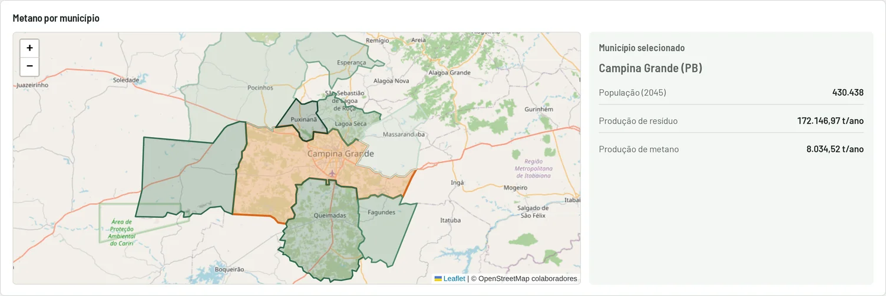
  <br><sub>Um clique no município mostra a população, o resíduo e o metano do ano escolhido. Os contornos vêm da API de malhas do IBGE, e o fundo, do OpenStreetMap.</sub>
</p>

### Galeria

<table>
  <tr>
    <td width="50%" valign="top">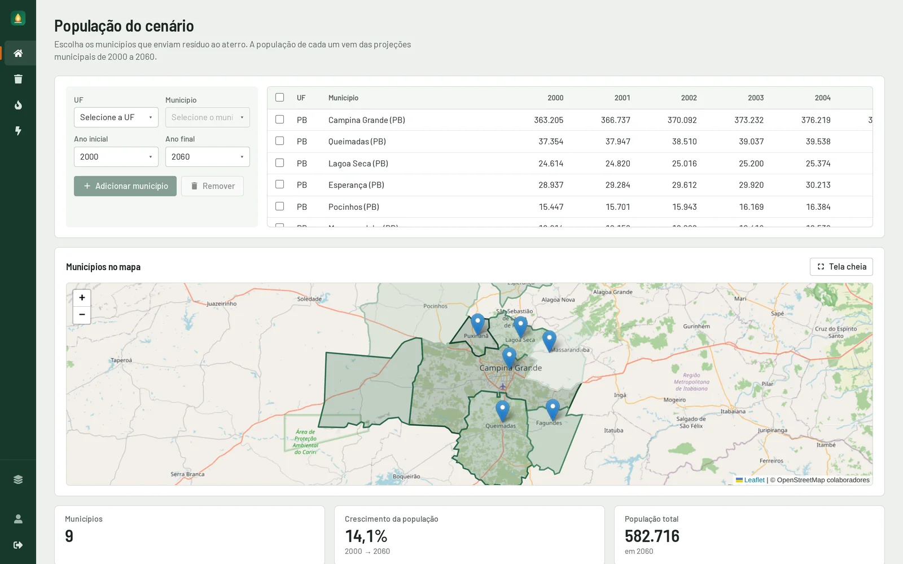<br><sub><b>Início</b>: resumo do aterro, escolha de UF e município e a população de cada município, ano a ano.</sub></td>
    <td width="50%" valign="top">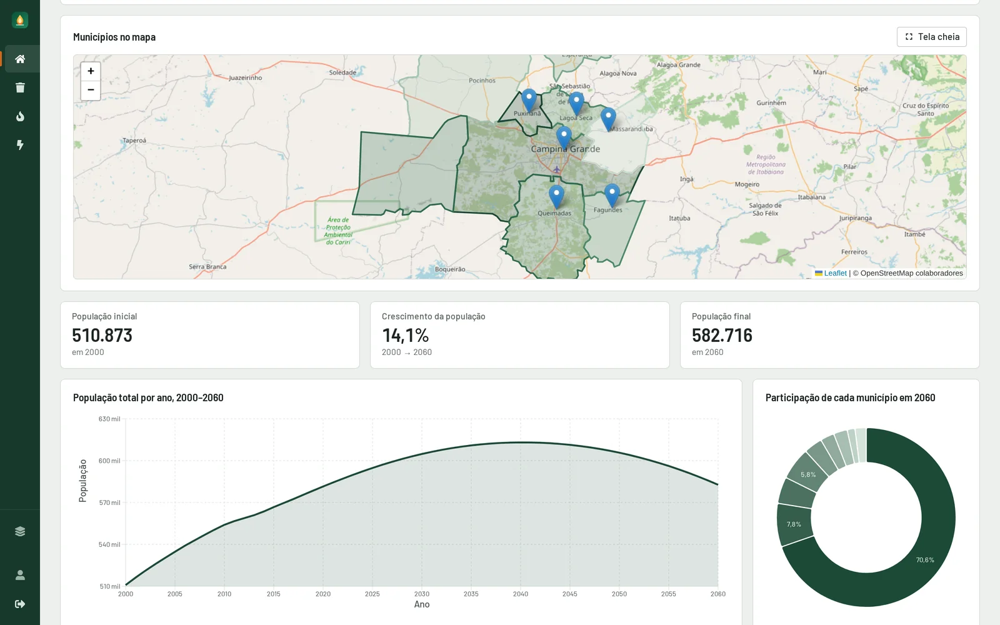<br><sub><b>Cenário no mapa</b>: os municípios, a população inicial e final e o crescimento até 2060.</sub></td>
  </tr>
  <tr>
    <td valign="top">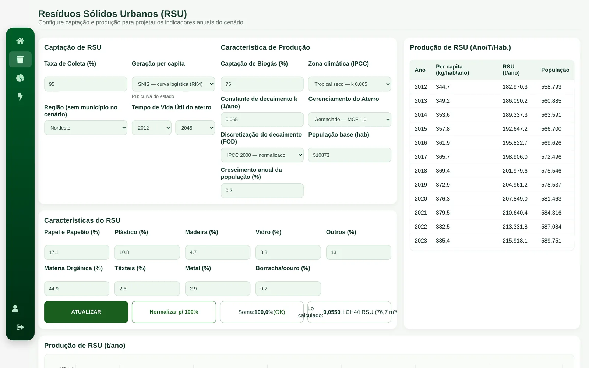<br><sub><b>Resíduos</b>: coleta, curva per capita (aqui, a da Paraíba), vida útil, zona climática, MCF, discretização e composição.</sub></td>
    <td valign="top">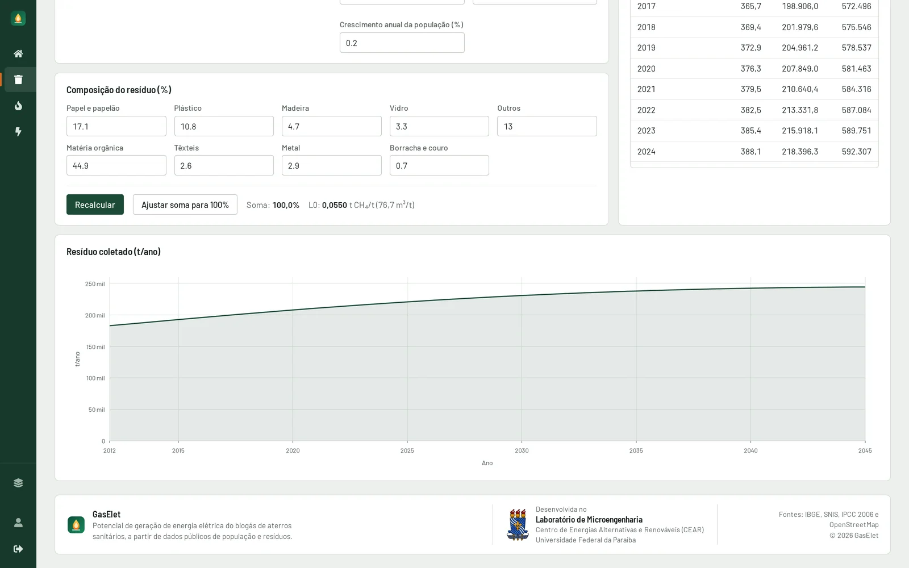<br><sub><b>Composição e coleta</b>: frações do resíduo, L0 resultante e a massa coletada a cada ano de operação do aterro.</sub></td>
  </tr>
  <tr>
    <td valign="top">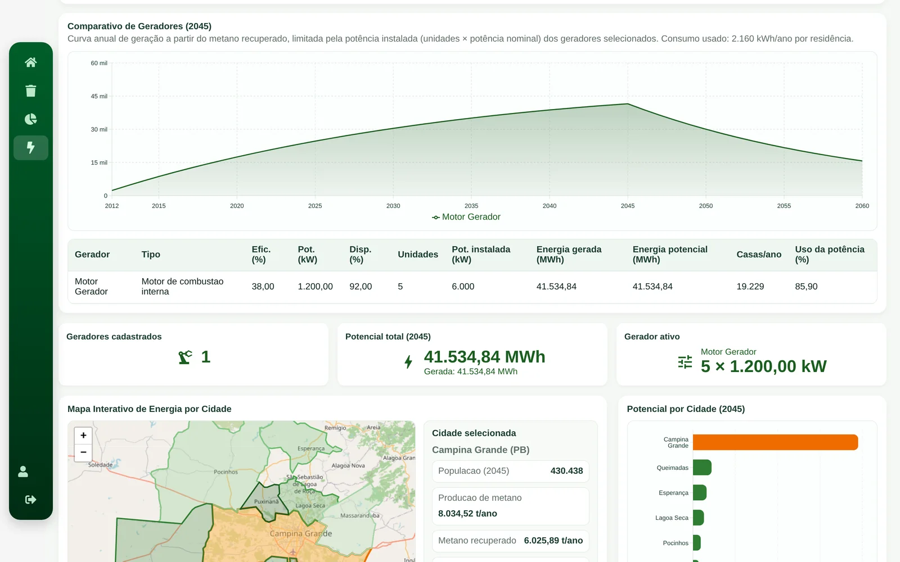<br><sub><b>Geradores</b>: energia anual limitada pela potência instalada, residências atendidas e uso da potência.</sub></td>
    <td valign="top">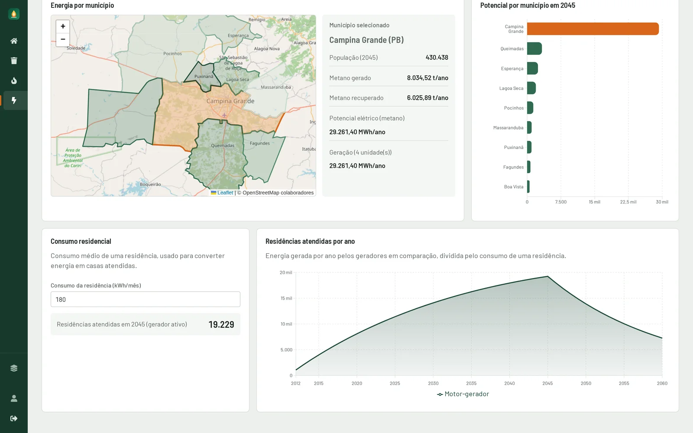<br><sub><b>Energia por município</b>: potencial de cada município no mapa e no gráfico, residências atendidas por ano e o rodapé com os créditos.</sub></td>
  </tr>
</table>

### No celular

<p align="center">
  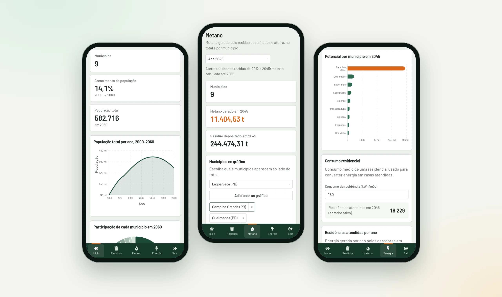
  <br><sub>No celular, a navegação vai para uma barra inferior com rótulos e os painéis ocupam a largura toda.</sub>
</p>

## Modelo de cálculo

Do município ao megawatt-hora, cada etapa usa a saída da anterior. A parte de resíduos e metano roda no servidor; a tela de Resíduos tem uma cópia em JavaScript para responder enquanto o usuário edita, e o servidor recalcula ao salvar.

| Etapa | Como é calculada | Onde |
|---|---|---|
| **População** | série anual do município (2000–2060); o cenário soma os municípios | `server/Dados/<UF>_populacao_2000_2060.json` |
| **Geração per capita** | logística `dg/dt = r·g·(1 − g/K)` integrada por Runge-Kutta 4 de 2000 a 2065, com a curva da UF ou da região | `PerCapita.cpp` · `rsuProduction.js` |
| **Massa de RSU** | `M = Σ população × per capita × taxa de coleta`, em t/ano, de `vidaInicio` a `vidaFim` | `UserDashboard.cpp` |
| **Potencial de metano** | `L0 = MCF × DOC × DOCf × F × 16/12`, com DOCf = 0,5, F = 0,5 e DOC pela composição | `UserDashboard.cpp` |
| **Metano gerado** | decaimento de primeira ordem: `Q(t) = Σₓ M(x) · L0 · (1 − e^−k) · e^−k(t−x)` (IPCC GPG 2000, Eq. 5.1) | `UserDashboard.cpp` |
| **Metano recuperado** | metano gerado × captação de biogás | `UserDashboard.cpp` |
| **Energia elétrica** | `P = CH₄ × 13.890 kWh/t × η / 8.760 h` e `E = min(P, N × Pnom) × 8.760 h × disponibilidade` | `Energy.jsx` |
| **Residências** | `E / (consumo mensal × 12)` | `Energy.jsx` |

<details>
  <summary><b>Parâmetros do IPCC 2006</b></summary>
  <br>

| DOC por fração (Vol. 5, Tab. 2.4, base úmida) | |
|---|---|
| Papel e papelão | 0,40 |
| Madeira | 0,43 |
| Borracha e couro | 0,39 |
| Têxteis | 0,24 |
| Matéria orgânica | 0,15 |
| Plástico, metal, vidro e outros | 0 (inertes) |

| Tipo de aterro (Tab. 3.1) | MCF |
|---|---|
| Gerenciado | 1,0 |
| Não gerenciado, profundo (≥ 5 m) | 0,8 |
| Não gerenciado, raso (< 5 m) | 0,4 |
| Não categorizado (aterro controlado ou lixão) | 0,6 |

| Zona climática (Tab. 3.3) | k (1/ano) |
|---|---|
| Tropical úmido | 0,17 |
| Tropical seco | 0,065 |
| Temperado úmido | 0,09 |
| Temperado seco (não ocorre no Brasil) | 0,05 |

A discretização `ipcc2000` (padrão) gera exatamente `L0 · M` por lote ao longo do tempo; `ipcc2006` atrasa o início da decomposição em 6 meses, como a planilha do IPCC; `legado` reproduz a fórmula usada até outubro de 2026.
</details>

<details>
  <summary><b>Curvas per capita do SNIS</b></summary>
  <br>

As curvas foram ajustadas à coleta per capita declarada no SNIS-RS (Co119 / Co164, 2003–2021), com a série de cada região corrigida pela entrada de municípios na amostra. Uma UF usa curva própria quando tem pelo menos 30 municípios, 60% da população coberta e intervalo de confiança do nível dentro de ±15%:

| Curva | UFs |
|---|---|
| **Própria** (curva da região reescalada para o nível do estado) | AM, BA, ES, GO, MG, MT, PA, PB, PR, RJ, RN, RS, SC, SE, SP |
| **Da região** | AC, AL, AP, CE, DF, MA, MS, PE, PI, RO, RR, TO |

Ajustando até 2016 e prevendo 2017–2021, a curva errou 8% em média, contra 15% das retas regionais do Panorama ABRELPE 2020, usadas nas versões anteriores (manter constante o nível de 2012–2016 errou 5%). Scripts, critérios e resultados estão em [`analise_sinis/`](analise_sinis/README.md).
</details>

## Arquitetura

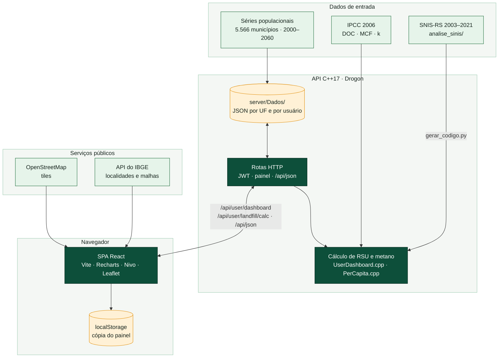

**Decisões de projeto**

| Decisão | Por quê |
|---|---|
| **Cálculo no servidor** | O metano dos gráficos vem do C++ (`UserDashboard.cpp`). O cliente tem uma cópia do modelo (`landfillModel.js`, `rsuProduction.js`) só para a tela de Resíduos responder na hora; ao salvar, o servidor recalcula as séries. |
| **Parâmetros gerados, não copiados** | Os parâmetros das curvas per capita ficam entre os marcadores `<gerado:snis-logistica>` no JavaScript e no C++ e são reescritos por `analise_sinis/scripts/gerar_codigo.py`. Cliente e servidor não divergem. |
| **Discretização antiga preservada** | `metodoFod = "legado"` reproduz o metano das versões anteriores, para comparar e refazer números já usados. |
| **Arquivos, não banco** | Cada usuário tem um JSON em `server/Dados/users/`, e a população fica em um JSON por UF. Os dados são fáceis de copiar, versionar e conferir. |
| **Sessão em cookie HttpOnly** | JWT assinado (validade de ~12 h) em cookie `HttpOnly` com `SameSite=Lax`, ou no cabeçalho `Authorization: Bearer`. O cadastro (`/signup`) só é aceito a partir da própria máquina do servidor. |
| **Salvamento automático** | O painel salva sozinho no servidor e guarda uma cópia no `localStorage`. No logout, as alterações pendentes são enviadas antes de sair. |
| **Mapas sob demanda** | O contorno de um município só é baixado da API de malhas do IBGE quando ele entra no cenário. |

## Stack

| Camada | Tecnologias |
|---|---|
| **Interface** | React 19, React Router 7, Vite 7, Recharts 3, Nivo 0.99, Leaflet 1.9 + React Leaflet 5, Turf 7, react-icons |
| **API** | C++17, Drogon, jwt-cpp, OpenSSL, libxcrypt (bcrypt), CMake 3.14+ |
| **Análise de dados** | Python com pandas, numpy, scipy e statsmodels (`analise_sinis/`) |
| **Identidade** | Barlow e Barlow Semi Condensed; verde da marca na navegação e nas ações, laranja da chama só para metano e energia (tokens em `client/src/styles/globals.css`) |
| **CI** | GitHub Actions: build do frontend e do backend a cada push na `main` e em pull requests |

## Como rodar

### Pré-requisitos

| Ferramenta | Versão | Necessária para |
|---|---|---|
| Node.js + npm | 20+ | interface |
| CMake + compilador C++ | CMake 3.14+, C++17 | API |
| Drogon, OpenSSL, libxcrypt | qualquer recente | API |
| Python 3 | qualquer recente | só para reajustar as curvas per capita |

### API

```bash
cd server
cmake -S . -B build -DCMAKE_BUILD_TYPE=Release
cmake --build build -j
JWT_SECRET="troque-este-segredo" ./build/drogon-react-ws   # HTTP em :7080
```

Rode a API a partir de `server/`: os usuários e os painéis são gravados em `server/Dados/users/`, um caminho relativo. Para criar o primeiro usuário, chame o cadastro na própria máquina do servidor:

```bash
curl -X POST http://localhost:7080/signup \
  -H "Content-Type: application/json" \
  -d '{"username":"admin","password":"Senha@123"}'
```

### Interface

```bash
cd client
npm install
npm run dev       # Vite em :5173, com proxy /backend → API
```

> O proxy `/backend` do [`client/vite.config.js`](client/vite.config.js) aponta para `http://192.168.0.203:7080`. Troque para `http://localhost:7080` se a API rodar na mesma máquina.

### Produção

```bash
cd client && npm ci && npm run build      # gera client/dist
cd ../server && JWT_SECRET="..." ./build/drogon-react-ws
```

O Drogon serve o build da SPA (`document_root`), devolve `index.html` nas rotas da SPA e redireciona para `/login` quem não está autenticado. Para HTTPS com Cloudflare Tunnel ou proxy reverso, veja [`docs/DEPLOY.md`](docs/DEPLOY.md). Para rodar como serviço no Windows (WSL2 + systemd ou NSSM), veja [`WINDOWS_SERVICO.txt`](WINDOWS_SERVICO.txt).

> `server/config.json` e `server/main.cpp` trazem caminhos absolutos da máquina de produção (`/home/victor/code/aterro_web/...`) para o `document_root` e para a pasta lida por `/api/json`. Ajuste-os ao seu ambiente.

### Configuração

| Variável ou chave | Padrão | Função |
|---|---|---|
| `JWT_SECRET` | `dev-secret-change-me` | assina os tokens; defina sempre em produção |
| `DROGON_CONFIG_FILE` | `config.json` | arquivo de configuração do Drogon; sem nenhum, a API sobe em HTTP na porta 7080 |
| `VITE_API_BASE` | vazio (mesma origem); `/backend` no `npm run dev` | endereço da API usado pelo build do cliente |
| `listeners` (`config.json`) | `0.0.0.0:7080` | endereço e porta HTTP |
| `document_root` (`config.json`) | `.../client/dist` | pasta do build servida pelo Drogon |

## API

Todas as rotas respondem JSON. As de painel, cálculo e dados exigem sessão (cookie `access_token` ou `Authorization: Bearer`). A referência completa está em [`docs/API.md`](docs/API.md).

<details>
  <summary><b>Ver os endpoints</b></summary>
  <br>

| Módulo | Endpoints |
|---|---|
| Autenticação | `POST /signup` (só da máquina do servidor) · `POST /login` · `GET /me` · `POST /logout` |
| Painel | `GET /api/user/dashboard` · `POST /api/user/dashboard` (mescla com o salvo e recalcula as séries) |
| Cálculo | `POST /api/user/landfill/calc`: RSU, per capita e metano gerado e recuperado por ano, no total e por município |
| Dados | `GET /api/json/{name}`: população por UF e lista de municípios de `server/Dados` |
| Tempo real | WebSocket `/ws` (`ping` e `chat`) e servidor TCP auxiliar na porta 2020 |

</details>

## Estrutura do repositório

```
GasElet/
├── client/                    # SPA React + Vite
│   ├── src/pages/             # Home (início), Rsu, Charts (metano), Energy, Login
│   ├── src/utils/             # modelo do aterro, per capita e chamadas à API
│   ├── src/context/ · auth/   # estado do painel (salvamento automático) e sessão
│   └── public/gaselet.svg     # ícone
├── server/                    # API C++17 / Drogon
│   ├── main.cpp               # inicialização, SPA, /api/json e servidor TCP
│   ├── controllers/           # AuthController, UserDashboard (RSU e metano), PerCapita, wschat
│   ├── filters/               # AuthFilter (valida o JWT)
│   ├── Dados/                 # população por UF (2000–2060), municípios e scripts de conversão
│   └── config.json            # listeners e document_root
├── analise_sinis/             # ajuste das curvas per capita: scripts, resultados e validação
├── include/ · external/       # bcrypt (libxcrypt e Bcrypt.cpp)
├── docs/                      # API, arquitetura, deploy e imagens deste README
└── .github/workflows/ci.yml   # build do frontend e do backend
```

## Fontes de dados

| Fonte | Uso na plataforma |
|---|---|
| [IBGE](https://www.ibge.gov.br) | séries populacionais municipais de 2000 a 2060 (método AiBi, censos de 2000 e 2010 e projeções estaduais); localidades e malhas municipais pela [API de serviços de dados](https://servicodados.ibge.gov.br/api/docs) |
| SNIS-RS, Ministério das Cidades | coleta per capita de resíduos (Co119 / Co164) de 2003 a 2021, base das curvas per capita |
| [IPCC 2006, Vol. 5](https://www.ipcc-nggip.iges.or.jp/public/2006gl/vol5.html) | DOC por fração (Tab. 2.4), MCF (Tab. 3.1) e k por zona climática (Tab. 3.3) |
| IPCC Good Practice Guidance 2000 | decaimento de primeira ordem normalizado (Eq. 5.1) |
| ABRELPE, Panorama dos Resíduos Sólidos no Brasil 2020 | comparação na validação das curvas per capita (`analise_sinis/`) |
| [OpenStreetMap](https://www.openstreetmap.org/copyright) | mapa de fundo (© colaboradores do OpenStreetMap, ODbL) |

Os dados pertencem às respectivas instituições e são usados com atribuição. As séries populacionais são estimativas e projeções, não contagens anuais.

## Créditos

<table>
  <tr>
    <td width="90" align="center"></td>
    
  </tr>
</table>

Para contribuir, veja [`CONTRIBUTING.md`](CONTRIBUTING.md); para reportar vulnerabilidades, [`SECURITY.md`](SECURITY.md). O histórico de mudanças está em [`CHANGELOG.md`](CHANGELOG.md).

## Licença

Este projeto está sob a licença **MIT**. Veja [`LICENSE`](LICENSE).

<br>

<p align="center">
  <br>
  <sub><b>GasElet</b> · do município ao megawatt-hora</sub>
</p>
